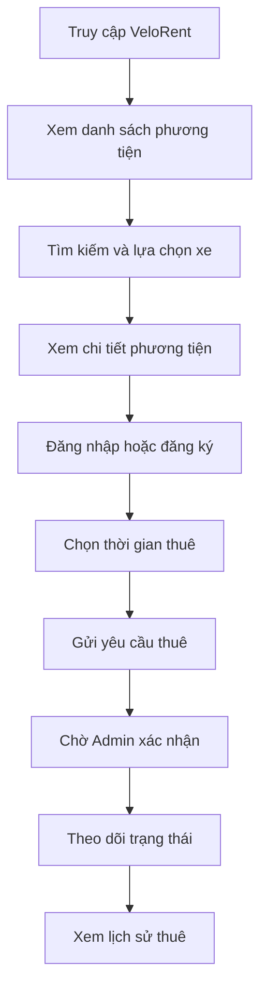
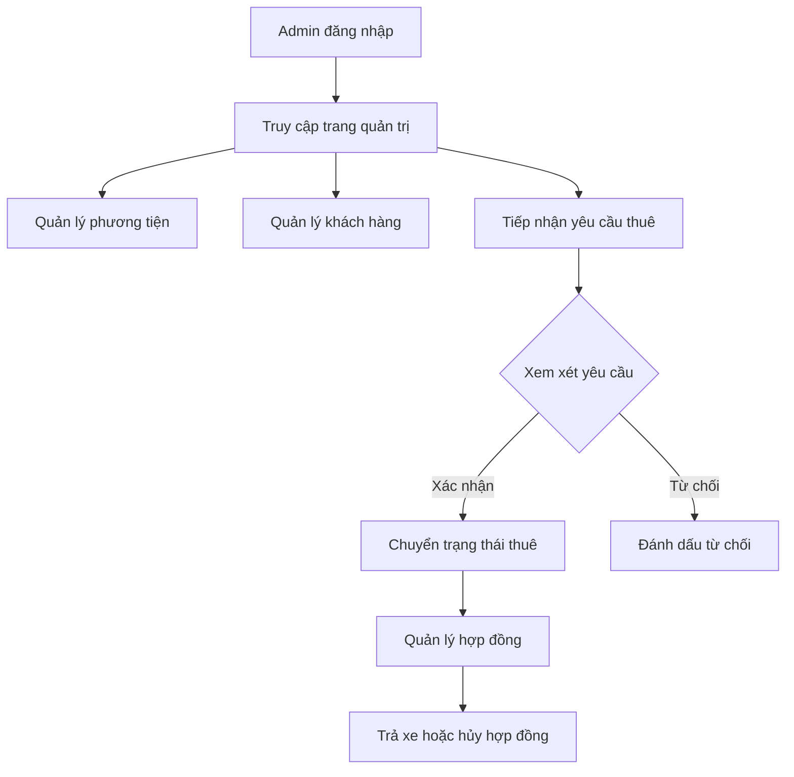
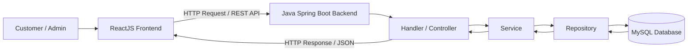

# VeloRent – Vehicle Rental Management System

<p align="center">

**HỆ THỐNG QUẢN LÝ CHO THUÊ PHƯƠNG TIỆN GIAO THÔNG**

Ứng dụng quản lý hoạt động cho thuê phương tiện, hỗ trợ khách hàng tìm kiếm và gửi yêu cầu thuê xe, đồng thời cung cấp hệ thống quản trị dành cho Admin để quản lý phương tiện, khách hàng, yêu cầu thuê và hợp đồng.

</p>

---

## 1. Giới thiệu dự án

**VeloRent** là hệ thống quản lý cho thuê phương tiện giao thông được xây dựng nhằm hỗ trợ số hóa quy trình thuê xe và quản lý hoạt động kinh doanh cho thuê phương tiện.

Hệ thống được phát triển theo mô hình Client–Server, gồm giao diện người dùng (Frontend), máy chủ xử lý nghiệp vụ (Backend) và cơ sở dữ liệu (Database).

VeloRent hướng đến việc đơn giản hóa quá trình tìm kiếm phương tiện, gửi yêu cầu thuê, quản lý thông tin khách hàng, kiểm soát lịch thuê và theo dõi trạng thái hợp đồng.

Dự án được xây dựng trong khuôn khổ học tập môn **Lập trình hướng đối tượng (Object-Oriented Programming – OOP)**, qua đó áp dụng các kiến thức về xây dựng lớp, đối tượng, đóng gói, kế thừa, trừu tượng và đa hình vào một ứng dụng thực tế.

---

## 2. Mục tiêu dự án

Các mục tiêu chính của VeloRent:

- Xây dựng hệ thống quản lý cho thuê phương tiện có giao diện trực quan và dễ sử dụng.
- Hỗ trợ khách hàng xem danh sách phương tiện và gửi yêu cầu thuê.
- Quản lý tập trung thông tin phương tiện và khách hàng.
- Hỗ trợ Admin tiếp nhận, xác nhận hoặc từ chối yêu cầu thuê.
- Quản lý trạng thái thuê và hợp đồng.
- Tự động tính toán chi phí thuê dựa trên giá thuê và thời gian thuê.
- Kiểm tra lịch thuê để hạn chế trùng lặp phương tiện.
- Áp dụng các nguyên lý OOP trong việc tổ chức và phát triển phần mềm.
- Xây dựng hệ thống có cấu trúc rõ ràng, dễ bảo trì và có khả năng mở rộng.

---

## 3. Công nghệ sử dụng

| Thành phần | Công nghệ | Vai trò |
|---|---|---|
| Frontend | ReactJS | Xây dựng giao diện và tương tác người dùng |
| Backend | Java | Ngôn ngữ xử lý nghiệp vụ |
| Backend Framework | Spring Boot | Xây dựng REST API và quản lý ứng dụng |
| Database | MySQL | Lưu trữ dữ liệu hệ thống |
| ORM | Spring Data JPA / Hibernate | Ánh xạ đối tượng Java với cơ sở dữ liệu |
| Build Tool | Maven | Quản lý dependencies và build backend |
| Frontend Tool | Vite | Khởi chạy môi trường phát triển frontend |
| Version Control | Git | Quản lý phiên bản mã nguồn |
| Repository | GitHub | Lưu trữ và cộng tác phát triển |

---

## 4. Các chức năng chính

### 4.1. Chức năng dành cho khách hàng

- Đăng ký tài khoản.
- Đăng nhập hệ thống.
- Xem trang chủ và thông tin dịch vụ.
- Xem danh sách phương tiện đang được cung cấp.
- Tìm kiếm và lọc phương tiện.
- Xem thông tin chi tiết phương tiện.
- Xem giá thuê phương tiện.
- Lựa chọn thời gian thuê.
- Gửi yêu cầu thuê phương tiện.
- Theo dõi trạng thái yêu cầu thuê.
- Xem lịch sử thuê phương tiện.

### 4.2. Chức năng dành cho Admin

- Truy cập khu vực quản trị.
- Xem tổng quan hệ thống.
- Quản lý phương tiện.
- Thêm phương tiện mới.
- Chỉnh sửa thông tin phương tiện.
- Xóa phương tiện.
- Xem danh sách phương tiện.
- Quản lý thông tin khách hàng.
- Xem danh sách yêu cầu thuê.
- Xem chi tiết yêu cầu thuê.
- Xác nhận yêu cầu thuê.
- Từ chối yêu cầu thuê.
- Quản lý hợp đồng thuê.
- Xử lý trả phương tiện.
- Xử lý hủy hợp đồng.
- Theo dõi trạng thái hợp đồng.

### 4.3. Quản lý phương tiện

Hệ thống hỗ trợ quản lý thông tin phương tiện, bao gồm các dữ liệu cơ bản:

- Biển số xe.
- Hãng xe.
- Giá thuê theo ngày.
- Loại phương tiện.
- Các thông tin đặc thù tùy theo từng loại xe.

Các thao tác quản lý được thực hiện thông qua giao diện Admin và được xử lý ở Backend trước khi lưu vào cơ sở dữ liệu.

### 4.4. Quản lý yêu cầu thuê

Quy trình gửi và xử lý yêu cầu thuê được tổ chức theo các bước:

1. Khách hàng lựa chọn phương tiện.
2. Khách hàng lựa chọn thời gian thuê.
3. Hệ thống kiểm tra các thông tin đầu vào.
4. Hệ thống tính toán chi phí thuê dự kiến.
5. Khách hàng gửi yêu cầu thuê.
6. Yêu cầu được lưu vào hệ thống với trạng thái chờ xác nhận.
7. Admin xem xét và xác nhận hoặc từ chối yêu cầu.

### 4.5. Quản lý hợp đồng và trạng thái

Hệ thống theo dõi trạng thái hợp đồng thuê phương tiện nhằm giúp Admin và khách hàng nắm bắt tiến trình thuê.

Các trạng thái nghiệp vụ chính:

| Trạng thái | Ý nghĩa |
|---|---|
| Chờ xác nhận | Yêu cầu thuê đang chờ Admin xử lý |
| Đang thuê | Hợp đồng đã được xác nhận và đang trong quá trình thuê |
| Đã trả | Phương tiện đã được hoàn trả |
| Đã hủy | Yêu cầu hoặc hợp đồng thuê đã bị hủy |

Việc quản lý trạng thái giúp hệ thống kiểm soát vòng đời của yêu cầu thuê và hợp đồng.

---

## 5. Quy trình hoạt động của hệ thống

### Quy trình khách hàng



### Quy trình Admin



---

## 6. Kiến trúc hệ thống

VeloRent được tổ chức theo mô hình tách biệt Frontend và Backend.

### Frontend – ReactJS

Frontend chịu trách nhiệm:

- Hiển thị giao diện người dùng.
- Tiếp nhận thao tác từ khách hàng và Admin.
- Hiển thị dữ liệu phương tiện, khách hàng và hợp đồng.
- Gửi request đến Backend thông qua API.
- Hiển thị kết quả xử lý và trạng thái nghiệp vụ.

### Backend – Java Spring Boot

Backend chịu trách nhiệm:

- Tiếp nhận request từ Frontend.
- Kiểm tra dữ liệu đầu vào.
- Xử lý các nghiệp vụ thuê phương tiện.
- Quản lý các đối tượng nghiệp vụ.
- Thực hiện các thao tác truy xuất dữ liệu.
- Kiểm tra điều kiện thuê và lịch thuê.
- Tính toán chi phí thuê.
- Trả kết quả cho Frontend thông qua API.

### Database – MySQL

Database được sử dụng để lưu trữ dữ liệu của hệ thống, đảm bảo dữ liệu có thể được truy xuất và quản lý xuyên suốt quá trình hoạt động.

Các nhóm dữ liệu chính bao gồm:

- Người dùng.
- Khách hàng.
- Phương tiện.
- Ô tô.
- Xe máy.
- Hợp đồng thuê.
- Các dữ liệu liên quan đến hoạt động thuê.

### Sơ đồ kiến trúc



---

## 7. Áp dụng lập trình hướng đối tượng (OOP)

OOP là nền tảng chính được sử dụng trong việc tổ chức các thành phần nghiệp vụ của VeloRent.

### 7.1. Encapsulation – Đóng gói

Đóng gói được áp dụng nhằm bảo vệ dữ liệu của đối tượng và kiểm soát việc truy cập thuộc tính.

Các thuộc tính trong lớp được quản lý thông qua các phương thức truy cập và xử lý phù hợp, hạn chế việc thay đổi dữ liệu tùy ý.

Ví dụ, đối tượng phương tiện quản lý thông tin biển số, hãng xe và giá thuê ngày.

### 7.2. Inheritance – Kế thừa

Hệ thống xây dựng lớp phương tiện chung `PhuongTien` và các lớp phương tiện cụ thể kế thừa từ lớp này.

Ví dụ:

- `PhuongTien`: lớp cơ sở chứa thông tin và đặc điểm chung.
- `OTo`: lớp đại diện cho ô tô.
- `XeMay`: lớp đại diện cho xe máy.

Các lớp con kế thừa những thuộc tính chung, đồng thời bổ sung thông tin riêng cho từng loại phương tiện.

### 7.3. Abstraction – Trừu tượng

Tính trừu tượng giúp mô hình hóa những đặc điểm chung của phương tiện và tách biệt những chi tiết triển khai cụ thể.

Lớp `PhuongTien` đóng vai trò mô hình chung cho các phương tiện, trong khi các loại phương tiện cụ thể được triển khai tại những lớp riêng.

### 7.4. Polymorphism – Đa hình

Các loại phương tiện khác nhau có thể được quản lý thông qua kiểu dữ liệu chung `PhuongTien`, đồng thời vẫn giữ các đặc điểm riêng của từng lớp cụ thể.

Điều này giúp giảm sự phụ thuộc vào từng loại phương tiện, hỗ trợ tái sử dụng code và mở rộng hệ thống khi cần bổ sung loại phương tiện mới.

### 7.5. Tổ chức trách nhiệm giữa các lớp

Backend được tổ chức theo các nhóm thành phần nhằm phân tách trách nhiệm xử lý:

| Thành phần | Trách nhiệm |
|---|---|
| Model | Biểu diễn đối tượng và dữ liệu nghiệp vụ |
| Handler | Tiếp nhận và xử lý request API |
| Service | Xử lý logic nghiệp vụ |
| Repository | Truy xuất và thao tác dữ liệu |
| Utils | Các phương thức hỗ trợ và kiểm tra dữ liệu |

Cách tổ chức này giúp giảm sự phụ thuộc giữa các thành phần và hỗ trợ bảo trì, kiểm thử và mở rộng hệ thống.

---

## 8. Cấu trúc thư mục

### Backend

```text
backend/
├── pom.xml
├── mvnw
└── src/
    ├── main/
    │   ├── java/
    │   │   └── com/
    │   │       └── vehiclerental/
    │   │           ├── main/
    │   │           ├── handler/
    │   │           ├── model/
    │   │           ├── repository/
    │   │           ├── service/
    │   │           └── utils/
    │   └── resources/
    │       └── application.properties
    └── test/
        └── java/
```

### Frontend

```text
frontend/
├── package.json
├── package-lock.json
├── vite.config.js
├── index.html
├── public/
└── src/
    ├── components/
    ├── pages/
    ├── assets/
    └── ...
```

*Lưu ý: Cấu trúc thực tế có thể thay đổi theo phiên bản code và các thành phần được bổ sung trong quá trình phát triển.*

---

## 9. Cài đặt và chạy dự án

### 9.1. Yêu cầu môi trường

Trước khi chạy dự án, cần cài đặt:

- Java JDK tương thích với backend.
- Maven hoặc sử dụng Maven Wrapper đi kèm dự án.
- Node.js và npm.
- MySQL Server.
- Git.

### 9.2. Clone repository

Clone phiên bản demo ổn định:

```bash
git clone -b demo-cuong https://github.com/KIENCNG/vehicle-rental.git
```

Di chuyển vào thư mục dự án:

```bash
cd vehicle-rental
```

### 9.3. Cấu hình cơ sở dữ liệu

Tạo database MySQL:

```sql
CREATE DATABASE vehicle_rental;
```

Cấu hình kết nối database trong file:

```text
backend/src/main/resources/application.properties
```

Ví dụ cấu hình:

```properties
spring.datasource.url=jdbc:mysql://localhost:3306/vehicle_rental?allowPublicKeyRetrieval=true&useSSL=false
spring.datasource.username=root
spring.datasource.password=YOUR_MYSQL_PASSWORD

spring.jpa.hibernate.ddl-auto=update
spring.jpa.show-sql=true
```

Thay `YOUR_MYSQL_PASSWORD` bằng mật khẩu MySQL trên máy của bạn.

> Không sử dụng hoặc commit mật khẩu thật, API key hay thông tin xác thực cá nhân vào repository công khai.

### 9.4. Chạy Backend

Mở Terminal tại thư mục backend:

```bash
cd backend
```

Trên macOS hoặc Linux:

```bash
./mvnw spring-boot:run
```

Trên Windows:

```cmd
mvnw.cmd spring-boot:run
```

Backend chạy tại:

```text
http://localhost:8080
```

### 9.5. Chạy Frontend

Mở Terminal thứ hai tại thư mục frontend:

```bash
cd frontend
```

Cài dependencies nếu cần:

```bash
npm install
```

Khởi chạy môi trường phát triển:

```bash
npm run dev
```

Frontend được cung cấp bởi Vite. Địa chỉ mặc định thường là:

```text
http://localhost:5173
```

Truy cập địa chỉ được Vite hiển thị trong Terminal để sử dụng ứng dụng.

---

## 10. Kiểm thử

Dự án có sử dụng kiểm thử nhằm xác minh hoạt động của các thành phần và nghiệp vụ Backend.

Các nội dung kiểm thử có thể bao gồm:

- Kiểm tra hoạt động của các lớp nghiệp vụ.
- Kiểm tra tính hợp lệ của dữ liệu đầu vào.
- Kiểm tra xử lý yêu cầu thuê phương tiện.
- Kiểm tra các điều kiện nghiệp vụ.
- Kiểm tra hoạt động của API.
- Kiểm tra các chức năng xử lý hợp đồng.

Chạy kiểm thử Backend:

```bash
cd backend
./mvnw test
```

Chạy build Backend:

```bash
./mvnw clean package
```

---

## 11. Hướng phát triển trong tương lai

VeloRent có thể được tiếp tục phát triển với các tính năng:

- Hoàn thiện giao diện và trải nghiệm người dùng.
- Bổ sung bộ lọc phương tiện nâng cao.
- Hoàn thiện phân quyền theo vai trò.
- Hoàn thiện quy trình quản lý thanh toán.
- Bổ sung báo cáo doanh thu và thống kê hoạt động thuê.
- Nâng cao khả năng quản lý lịch thuê.
- Tăng cường kiểm tra dữ liệu và bảo mật.
- Tối ưu hiệu năng truy xuất dữ liệu.
- Bổ sung kiểm thử tự động cho các nghiệp vụ quan trọng.

---

## 12. Thành viên thực hiện

Dự án được xây dựng và phát triển trong quá trình học tập môn Lập trình hướng đối tượng.

Các thành viên tham gia phát triển được ghi nhận thông qua lịch sử commit trên GitHub.

GitHub repository cung cấp lịch sử mã nguồn, các commit, thay đổi trên từng file và thông tin đóng góp của từng thành viên.

---

## 13. Repository

GitHub:  
https://github.com/KIENCNG/vehicle-rental

Phiên bản demo ổn định:  
https://github.com/KIENCNG/vehicle-rental/tree/demo-cuong

---

## 14. Kết luận

VeloRent là dự án ứng dụng kiến thức lập trình hướng đối tượng vào xây dựng một hệ thống quản lý cho thuê phương tiện giao thông.

Thông qua dự án, các kiến thức về thiết kế lớp, tổ chức đối tượng, đóng gói, kế thừa, trừu tượng, đa hình và phân chia trách nhiệm trong phần mềm được áp dụng vào các nghiệp vụ thực tế.

Bên cạnh việc xây dựng các chức năng quản lý, dự án cũng giúp củng cố kiến thức về Java, Spring Boot, ReactJS, MySQL, REST API và quy trình quản lý mã nguồn bằng Git/GitHub.

**VeloRent – Simplifying Vehicle Rental Management.**
